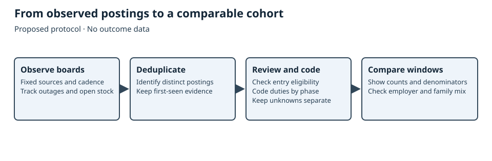

# The Junior’s Curve: What Employers Ask of Entry-Level STEM Workers

*Working methods draft. Proposed protocol, not preregistered. No new findings are reported.*

## Abstract

An entry-level title does not tell us whether a posting welcomes new entrants or what work it asks them to do. We propose a U.S. employer-board study that establishes entry eligibility from advertisement text, assigns job families from duties, and codes described work into six phases. The primary measure is the share of distinct eligible postings in a family that describe at least one verification duty. Comparable collection windows and fixed-composition checks distinguish changes in language within families from changes in which employers and roles are visible. Separately reported requirements, mentorship, and unresolved cases keep silence in an advertisement from being mistaken for silence in the workplace.

## Research question and scope

What work do employers explicitly ask new entrants to perform across technical STEM, and does that language change within comparable job families over time? The motivating hypothesis is that advertisements in coding-intensive families increasingly name tasks that check outputs, such as validating a proposed change. This may be false: mentions can stay flat, decline, or appear to rise only because the mix of jobs and employers changed. The technical families span software and QA, data and AI, systems and security, physical engineering, applied science, and technical implementation, product, or program roles when duties support inclusion. A master’s degree is neither required nor sufficient.

The [parent study](https://github.com/nikbearbrown/a-new-shape-for-work/blob/366b575ccfaa3c3ce1a23eb34cbce83c33a708cf/README.md#L7-L15) distinguishes modeled occupational effort derived from O*NET task ratings, what employers emphasize in job ads, and published evidence of tasks people bring to Claude. This paper uses only the posting layer. [Burning Glass Institute and Break Through Tech](https://www.burningglassinstitute.org/research/the-consequence-gap) report more code-review skill mentions over time in their entry-level technology sample. That motivates a comparison but is not its baseline: a named skill is not necessarily an assigned duty, and technology occupations are not all of STEM. [SkillSpan](https://aclanthology.org/2022.naacl-main.366/) provides precedent for annotating skill spans; our unit of reporting is a posting and our target is a described action.

## Build the cohort before measuring change

Fix the board list, collection cadence, geography, search rules, times in UTC, and family definitions before collecting comparison windows. Log fetch failures, accessible denominators, listing dates when supplied, and what the parser could extract. Use the employer and requisition identifier where available; otherwise use a versioned matching rule combining normalized employer, title, location and text similarity, with borderline matches reviewed independently. Keep edits under the same ID. Report repost treatment and sensitivity rather than assuming the matching rule distinguishes every requisition from a repost. The primary series counts distinct ads newly observed after a proposed two-week warm-up, grouped by UTC calendar week; an initial stock snapshot or an ad reappearing after a board outage is not an inferred new vacancy.

Assign one of three statuses: **description-supported entry** (explicit new-graduate pathway or stated minimum required relevant experience no greater than two years, without another blocking hard experience requirement); **title-only lead** (entry-looking title but insufficient description); or **unclear** (missing or conflicting text). Set aside ads with clearly higher hard minima or that otherwise fail scope. Treat two years as a study convention, not a labor-market definition; repeat with a stricter one-year threshold and explicit new-graduate routes only. Parse required and preferred qualifications separately, preserve conflicting seniority cues, and exclude internships and co-ops from the main analysis. A “junior” title alone does not qualify a posting. Review plausible false negatives from outside the title candidate filter rather than validating only its accepted cases.

## Code duties, not titles

Slice description sections into attributable action clauses. Distinguish duties from qualifications, general traits, benefits and boilerplate, with a flag for unclear or mixed text. Use the same six phases as the parent study: **Understand** the problem, **Plan** the response, **Produce** an output, **Check** its fit or correctness, **Sustain** it in use, and **Coordinate** with others. Split a compound line only where it contains independently actionable duties, then roll up each phase at most once per posting. A hypothetical statement such as “reproduce a faulty reading, then verify the repaired instrument against a reference” supports Understand and Check. A requirement to know the instrument’s software, standing alone, is not a duty. Code AI tool language, required and preferred credentials, experience, and explicit onboarding or mentorship in separate fields.

Freeze the instructions and example set before comparison coding. On a held-out audit subset stratified by family, window, and candidate status, have two reviewers label eligibility, family, extraction adequacy, and phases independently before adjudication. Report coverage, exact agreement, per-phase counts and error modes, distinguishing extraction misses from labeling disagreement. Preserve original decisions. Use known ambiguous cases for development, not as the only test. If coding uses models, pin prompts, versions, settings, and retry rules; use an independently human-reviewed holdout, not agreement between models as validation.

**Figure 1. Proposed workflow, not data.** Source snapshots → distinct ads → eligibility and duty coding → comparable aggregates. Keep counts at each gate and record what could not be classified.

| Snapshot and coverage | Distinct observed posting | Eligibility and duties | Public comparison |
|---|---|---|---|
| Fixed source frame; establish warm-up; log outages | Deduplicate IDs and reposts; retain first-seen evidence | Separate supported entry from title-only, unclear and out-of-scope; code families and phases | Compare normalized windows; show counts, denominators, unknowns and fixed-mix sensitivity |
| Keep initial open stock separate | Audit borderline duplicate pairs | Independently review accepted and rejected candidates | Release only permitted aggregates, methods and synthetic fixtures |

## Compare like with like

The primary outcome is, within each prespecified coding-intensive family, the number of eligible ads with at least one Check duty divided by the number of eligible ads with scorable duty text. Report the full eligible count, nonscorable count, and a missingness sensitivity that treats unresolved eligible ads first as none and then as all mentioning Check. No mention in scorable text means **not stated**, not **not performed**. Because phases can coexist, their shares need not total 100%. Report the percentage-point difference between defined windows; do not divide by the number of extracted phrases. Nominate coding-intensive families before examining the direction.

Require at least four complete weekly cohorts from a fixed observation frame before a first prospective summary. This is a coverage gate, not a test of statistical power or a long-run trend. Before using those cohorts for comparisons, lock the window dates, minimum board availability and cell-size rules, and how unresolved cases are handled. Report calendar cutoffs and exclusion counts alongside results. A historical difference requires matched board coverage and eligibility, collection, and annotation rules, with comparable seasons where practical. Publish family and employer coverage and compare pooled estimates with estimates under fixed family weights and on common employers. State how much coverage is lost in the common-employer restriction. Break out major job subfamilies and geographies where sample size allows, since role mix can change even within one family. A result explained by shifts in observed employers or role composition is evidence of a changed sample, not the predicted within-family pattern. Set and record minimum board-day coverage, minimum scorable-duty coverage, and cell-release rules before reading results. If a window fails those rules or other source changes prevent comparison, publish a coverage report instead of a trend. These are descriptive contrasts. If reporting intervals for a broader process that generated the observed ads, justify the model and dependence assumptions in advance; employer-clustered resampling within comparable windows is one candidate, not a correction for missing employers.

## What this will not show

[Comparative evidence from Cedefop](https://www.cedefop.europa.eu/files/6217_en.pdf) finds that online-ad coverage differs from official statistics across occupations and other strata. This board sample cannot estimate actual openings, hiring, or how employees spend their time. [Raymond and Dillon](https://economics.mit.edu/sites/default/files/2026-11/AILaborDemand_06Nov2026.pdf) study hiring under a distinct firm-level adoption design; their findings do not identify the cause of any language change here. Neither a change in advertised duties nor a lack of mentorship language measures training or what juniors learn. Those require separate linked hiring, work observation, or learning studies. Preserve posting text and annotations only under authorized access; release documentation, synthetic fixtures, and disclosure-checked aggregates.

## Claim and source ledger

| Claim or design dependency | Source and locator | Boundary |
|---|---|---|
| Scope and six phases extend an existing framework | [Junior’s Curve posting methods, pinned](https://github.com/nikbearbrown/the-juniors-curve/blob/88518bccecfab0939175efdd628d06f80f07e0e7/methods/entry-level-stem.md); [parent README, pinned](https://github.com/nikbearbrown/a-new-shape-for-work/blob/366b575ccfaa3c3ce1a23eb34cbce83c33a708cf/README.md) | Design provenance, not validation; thresholds in this draft are proposals. |
| Related entry-level tech ads report increasing code-review skill mentions | [Burning Glass Institute and Break Through Tech, findings](https://www.burningglassinstitute.org/research/the-consequence-gap) | Their defined tech sample and skill measure, not our cohort or outcome. |
| Skill spans are an established annotation unit | [Zhang et al., SkillSpan, abstract](https://aclanthology.org/2022.naacl-main.366/) | Distinct from posting-level duty presence. |
| Coverage may differ from official sources | [Napierala et al., Cedefop working paper, §§4–6](https://www.cedefop.europa.eu/files/6217_en.pdf) | EU evidence, no validation of the proposed U.S. frame. |
| Hiring and posting-language studies answer different questions | [Raymond and Dillon, November 6 working paper, abstract and study design](https://economics.mit.edu/sites/default/files/2026-11/AILaborDemand_06Nov2026.pdf) | Adoption-induced hiring change in their setting, not a test of this paper’s hypothesis. |
